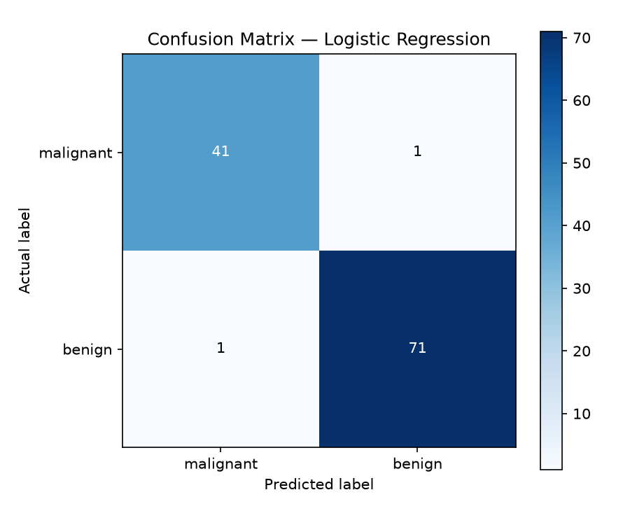

# Breast Cancer Classification

A machine learning project using Logistic Regression to classify breast cancer data.

## Dataset

This project uses the Breast Cancer Wisconsin dataset built into scikit-learn.

- Samples: 569
- Features: 30 numerical features
- Target classes: Malignant and Benign
- Source: `sklearn.datasets.load_breast_cancer`

## Model

The project uses Logistic Regression, a supervised machine learning algorithm.

A StandardScaler is used to standardize the numerical features before training.

The data is split into training and testing sets, and 5-fold cross-validation is used to evaluate model performance during model selection.

## Results

- Mean 5-fold cross-validation accuracy (baseline model): 95.16%
- Mean 5-fold cross-validation accuracy (scaled model): 98.02%
- Test accuracy: 98.25%
- Test samples: 114
- Correct predictions: 112
- Incorrect predictions: 2
- False negative: 1
- False positive: 1
- Malignant recall: 97.62%

The model's performance was evaluated using accuracy, a confusion matrix, and a classification report containing precision, recall, and F1-score.

## Conclusion

The scaled Logistic Regression model achieved 98.25% accuracy on the held-out test set. This project demonstrates data splitting, feature scaling, cross-validation, model training, and classification evaluation using scikit-learn. Although the model achieved 98.25% test accuracy, this result may not generalize to real-world data because the dataset is relatively small and may not represent the full complexity and diversity of real-world cases.

## Limitations

- This is an educational project, not a clinically validated diagnostic tool.
- Accuracy alone does not capture every type of classification error.
- Results may differ with other data splits or datasets.

## How to Run

1. Clone the repository:
   `git clone https://github.com/shreyashsharma45-sudo/Breast-Cancer-Classification.git`

2. Navigate into project folder:
   `cd Breast-Cancer-Classification`

3. Install the required libraries:
   `pip install -r requirements.txt`

4. Run the project:
   `python first_ml_project.py`   